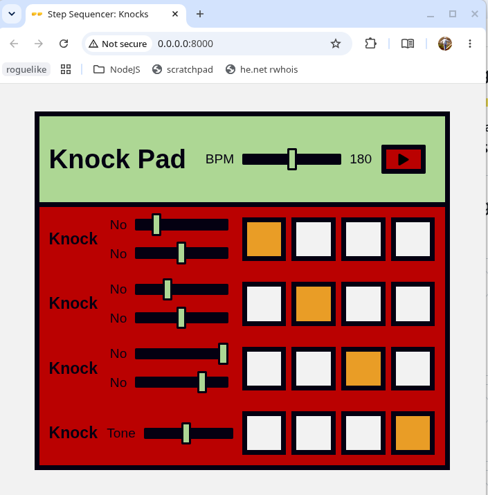

## Knocks Sequencer

A 60min hack for Recurse Center Creative Coding prompt, "Knock On Wood"
2026-11-11

Derived from the Mozilla Developers Web Audio Samples repository's "step sampler" and mostly not cleaned-up. See the original code for [step-sequencer](https://github.com/mdn/webaudio-examples/tree/main/step-sequencer) with the sound effects we left out.

See [MDN Web Audio API Advanced Techniques](https://developer.mozilla.org/en-US/docs/Web/API/Web_Audio_API/Advanced_techniques) for the docs, including the unused Sweep, Pulse, and Noise techniques. We only used the sample and the sequencing. 

In order to allow media resource loading, run a server:
* python3 -m http.server  # runs in foreground
* busybox httpd -p 8000   # runs in background

and visit http://localhost:8000/ with your browser.

| Team        |                                                         |
|-------------|---------------------------------------------------------|
| Briana Gude | Sharp Eyes for Styles, Code, and Remote Pairing         |
| Ryker Lee   | All the Knocks and More                                 |
| Jeff Miller | Mozilla Developer Network and Browser Inspector Fan Boy |

